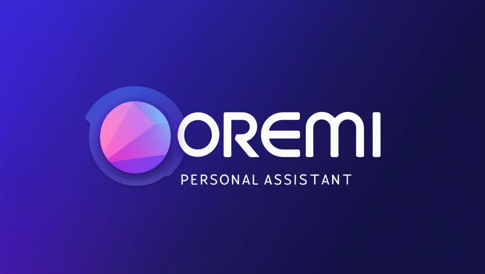

# Oremi Device

Oremi Device captures microphone audio and connects it to Oremi services:

- **Oremi Ohunerin** detects wake words and environmental sounds.
- **Oremi Andika** transcribes speech after Ohunerin detects a wake word.
- **Oremi Izwi** or an OpenAI-compatible Edge-TTS server synthesizes spoken NLP responses when configured.
- **MQTT** exposes events, device controls, availability, and Home Assistant
  discovery entities.

The application monitors audio hardware while it runs. It can switch to another
compatible microphone when the active device disappears and switch back when a
preferred device becomes available again.

## Documentation

All project documentation—including architecture details, configuration
reference, and the Home Assistant integration guide—can be found at:
https://demsking.gitlab.io/oremi-device/

## Development

Oremi Device is built with Python and uses `uv` for dependency management. The
project follows standard Python development practices with type hints, linting,
and automated testing.

For detailed information on setting up your development environment, running
tests, code style guidelines, and the pull request process, please refer to
[CONTRIBUTING.md](https://gitlab.com/demsking/oremi-device/-/blob/main/CONTRIBUTING.md).

## Versioning

Given a version number `MAJOR.MINOR.PATCH`, increment the:

- `MAJOR` version when you make incompatible API changes,
- `MINOR` version when you add functionality in a backwards-compatible manner,
  and
- `PATCH` version when you make backwards-compatible bug fixes.

Additional labels for pre-release and build metadata are available as extensions
to the `MAJOR.MINOR.PATCH` format.

See [SemVer.org](https://semver.org/) for more details.

## License

Copyright 2026 Sébastien Demanou. All Rights Reserved.

Licensed under the Apache License, Version 2.0. See the
[LICENSE](https://gitlab.com/demsking/oremi-device/-/blob/main/LICENSE) for the
complete license text.
